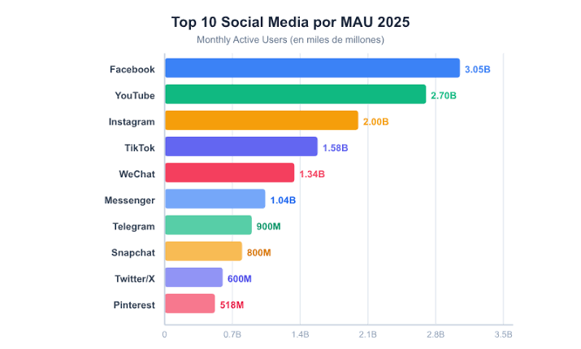
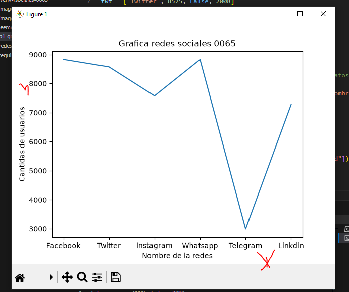
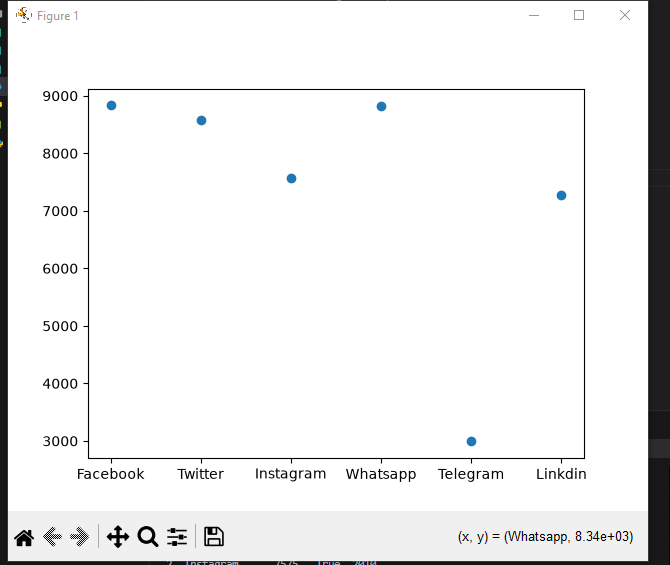
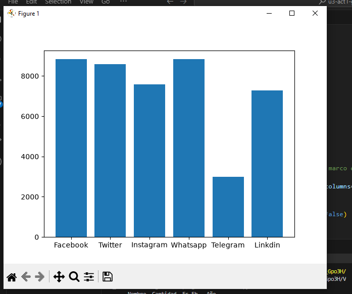
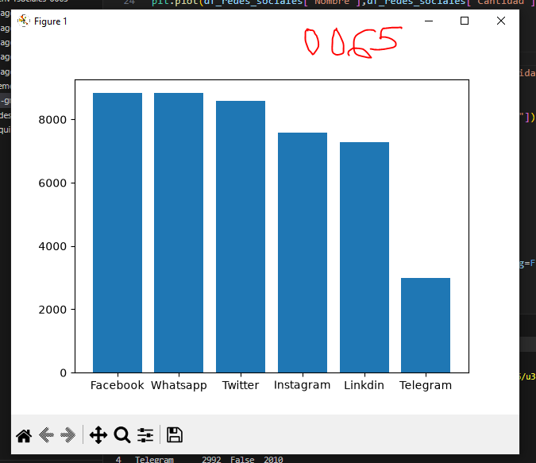
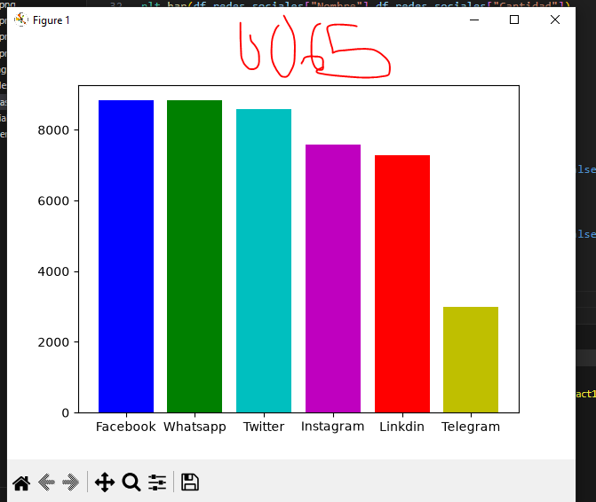
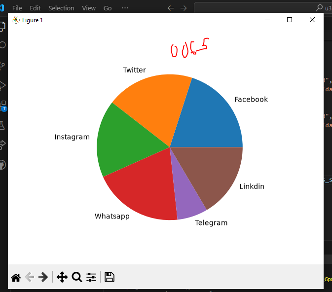

## dataframe o marco de datos

## redes sociales a nivel mundial

## grafica de redes sociales 

## grafica de puntos

## grafica de barrras

## fraficas ordenada de mayor a menor

# coloreando la grafica

## grafica de pastel o pie
